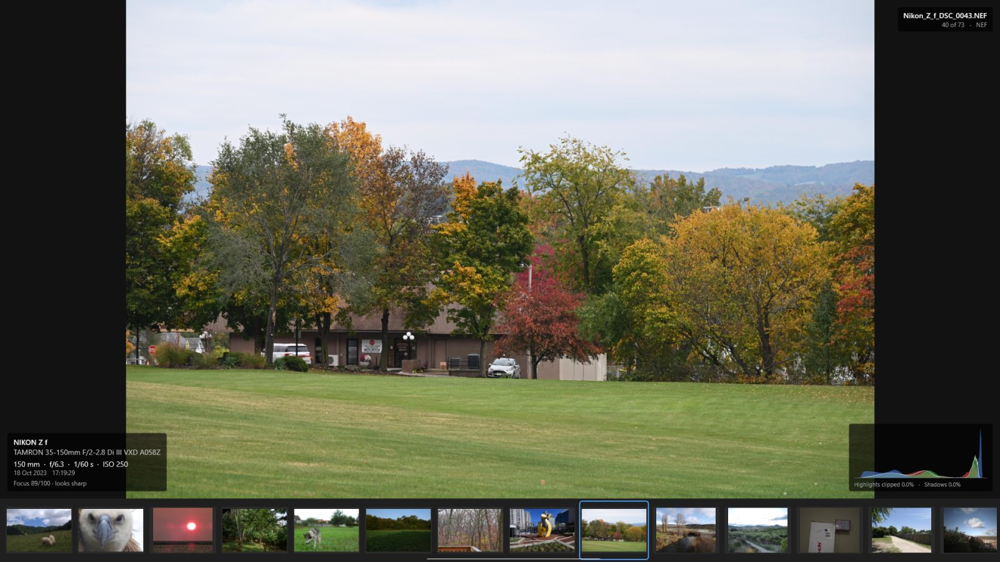
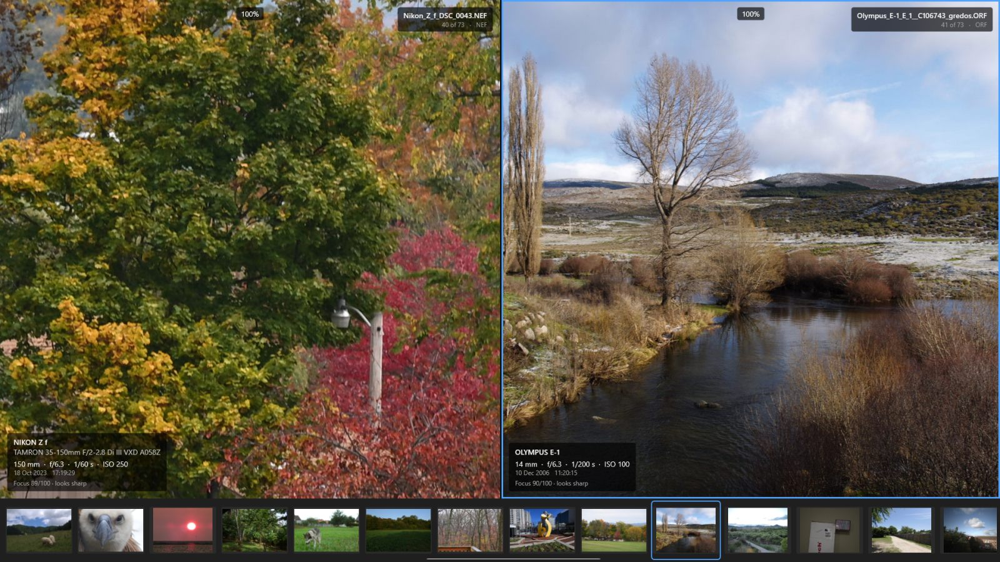

# SnapCull

**Fast, free photo culling for Windows.** [Get it from the Microsoft Store](https://apps.microsoft.com/detail/9PLWMRJ8BVTS). Open a folder straight off your memory card, flip through hundreds of RAW files instantly, and pick the keepers with one key per photo. SnapCull flags blurry shots for you, puts similar frames side by side, and saves your ratings as `.xmp` sidecars that Lightroom, Capture One, Bridge and darktable pick up automatically.





## Why it's fast

Every RAW file has a full-size JPEG preview hidden inside it, put there by the camera. SnapCull reads that preview directly instead of processing the raw sensor data, so photos appear as quickly as you can press the arrow keys. Photo Mechanic works the same way. It also:

- decodes photos at screen size, and only decodes full resolution when you zoom to 100%;
- decodes the next and previous photos ahead of time;
- loads filmstrip thumbnails in the background, starting with the photos around the one you're looking at;
- saves ratings on a background thread, so pressing a key never waits for the disk.

## Features

- **Works with almost any camera.** See [supported cameras](#supported-cameras). There are no external libraries: SnapCull has its own small TIFF, EXIF, CR3, CRW, MRW and HEIF readers.
- **RAW + JPEG or RAW + HEIF pairs** are treated as one photo.
- **Pick / reject / 1–5 stars / colour labels**, all from the keyboard.
- **Auto-advance:** rate a photo and the next one appears. Hold Shift to do the opposite.
- **Focus check:** every photo gets a sharpness score in the background. Soft and blurry shots get an orange **SOFT** or red **BLUR** badge, and the *Blurry or soft* filter shows them all at once so you can reject them quickly.
- **Compare mode (C):** two photos side by side. Zoom to 100% and both sides zoom to the same spot; pan one and the other follows, so you can see which frame is sharper.
- **Best of burst:** frames shot in quick succession are grouped automatically, using capture times to the hundredth of a second and a colour fingerprint of each frame. SnapCull then picks the **sharpest frame of each burst (★ BEST)**. It compares every frame at about 2000 px **where the subject is** (the area that's sharpest in any frame), so it catches missed focus, motion blur and camera shake, with a small penalty for blown highlights. Each frame gets a rank and a reason, such as *"#3 · a little softer than the best"*.
  - **B** opens **burst review**: every frame side by side, best first, each as a **100% crop of the same spot on the subject**.
  - **K** keeps the best frame and rejects the rest in one go (**Ctrl+Z** undoes it).
  - Filters: *Bursts only*, *Best of each burst*, and *Collapse bursts* (single shots plus each burst's best).
  - The gap between frames (default 1 s) can be changed in burst review.
- **Zoom properly:** click or **Z** for fit ↔ 100% at that spot, **+ / −** for steps from fit up to 800%, **Ctrl + mouse wheel** (or a touchpad pinch) to zoom around the pointer, **Ctrl+0 / Ctrl+1** for fit / 100%. Drag to pan. Above 200% pixels are shown crisp, for checking focus.
- **Grid view (G):** every photo as a thumbnail, with the same badges as the filmstrip (pick, reject, stars, label, BLUR/SOFT, burst rank).
  - Thumbnails go from 100 to 420 px: use the slider in the status bar, **Ctrl + mouse wheel** (or pinch), or **+ / −**. Big thumbnails load sharper versions for the photos on screen.
  - Arrows move, **Enter** or a double-click opens a photo, and **G** or **Esc** goes back.
  - **Select several** with Ctrl+click, Shift+click, Shift+arrows or Ctrl+A, then press P, X, U, 0–5 or 6–9 to rate them all at once (one Ctrl+Z undoes it).
  - With two photos selected, **C** compares them side by side.
  - It stays fast with thousands of photos, because only the rows on screen are drawn.
- **Histogram (H)** with the percentage of clipped highlights and shadows.
- **Camera info overlay:** body, lens, focal length, aperture, shutter speed, ISO, **resolution and megapixels, file size**, date, focus score and burst rank.
- **Sort by capture time**, so a shoot from two cameras stays in the order it happened.
- **Subfolders:** cull a whole shoot spread over several card folders in one go.
- **Filters:** picks, rejects, not yet flagged, ★ and up, blurry or soft, sharp.
- **Copy or move your picks** (with their paired JPEG/HEIF and sidecars) to another folder. Existing files are never overwritten.
- **Convert photos (Ctrl+Shift+E)** to **JPEG, PNG, TIFF (8 or 16-bit), WebP or HEIC**, from RAW or any supported image:
  - resize to a long edge (for example 2048 px for Instagram) or a percentage;
  - for RAW files, use the camera's preview (instant) or a full render of the raw data (most detail). *Automatic* picks the render when the preview is small;
  - keep camera, lens, settings and date, and optionally **remove the GPS location** before sharing;
  - name files with a pattern such as `{date}_{name}` or `Wedding_{seq}`.

  Photos are saved the right way up. Your originals are never changed, and existing files are never overwritten. You can keep culling while a batch converts.
- **Right-click a photo** to open it in your editor, show it in File Explorer, or copy its path.
- **Undo** with Ctrl+Z.
- Dark Windows 11 style UI, full-screen mode, and correct sizing on high-DPI screens.

## Keyboard shortcuts

| Key | Action |
|---|---|
| ← → | Previous / next photo |
| P / X / U | Pick / reject / clear flag |
| 1–5, 0 | Star rating / clear stars |
| 6 7 8 9 | Red / yellow / green / blue label |
| Shift + rating key | Rate, doing the opposite of auto-advance |
| A | Auto-advance on/off |
| Z, Space or click | Fit ↔ 100% |
| + / −, Ctrl + wheel | Zoom in / out (up to 800%) |
| Ctrl+0 / Ctrl+1 | Fit to window / 100% |
| G | Grid view (Enter opens a photo) |
| Ctrl/Shift + click, Shift + arrows, Ctrl+A | Grid: select several photos, then rate them all |
| C | Compare mode (in the grid: the two selected photos) |
| B | Burst review (all frames of a burst, best first) |
| K | Keep the burst's best frame, reject the rest |
| Tab | Compare mode: switch sides. Otherwise: filmstrip on/off |
| H | Histogram |
| I | Camera info and focus score |
| F or F11 | Full screen |
| Ctrl+Z / Ctrl+O / Ctrl+E | Undo / open folder / copy or move picks |
| Ctrl+Shift+E | Convert photos |
| ? or F1 | Show all shortcuts |

## Supported cameras

SnapCull is tested against real sample files from [raw.pixls.us](https://raw.pixls.us): **72 of 73 cameras work**. The ones marked † store no usable preview, so SnapCull asks Windows' free [Raw Image Extension](https://apps.microsoft.com/detail/9NCTDW2W1BH8) to render the raw data instead. This is slower (1–7 s per photo), but it works. That extension comes with most Windows 11 PCs.

| Maker | Tested models | Formats |
|---|---|---|
| Canon | EOS R5 Mark II, R6, R10, M200, 1D X Mark III, 90D, 5D Mark IV, 700D, 300D, 10D | CR3, CR2, CRW |
| Nikon | Z 9, Z f, Z 6II, D850, D3500, D70, 1 J5, Coolpix P1000 | NEF, NRW |
| Sony | α1, α7R V, α7 IV, α7 III, α6400, NEX-5N, RX100 VII, DSLR-A100† | ARW |
| Fujifilm | X-T5, X-T3, X100VI, X-A5, FinePix S5 Pro | RAF |
| OM System / Olympus | E-M1 II, E-M10 IV, TG-6, E-1 | ORF |
| Panasonic / Leica | G9, S5, GH4, LX100, FZ1000, D-LUX (Typ 109) | RW2, RWL |
| Pentax / Ricoh | K-1, K-3 III, K-70, K10D, Q7, GR III | PEF, DNG |
| Leica | M10, Q (Typ 116), M8† | DNG |
| Phones | iPhone 12 Pro, Pixel 7 Pro, Galaxy S23 Ultra, Xiaomi Mi 8, Huawei P20 lite†, OnePlus 6† | DNG |
| Drones | DJI Phantom 4 Pro, DJI Mavic Air 2 | DNG |
| Medium format and others | Mamiya ZD, Leaf Aptus 22, Kodak P880, Kodak DCS Pro 14nx†, Minolta Dynax 7D†, Minolta DiMAGE A2†, Samsung NX1, NX300, EX2F, Sigma DP1 Merrill, SD15, fp†, Epson R-D1† | MEF, MOS, KDC, DCR, MRW, SRW, X3F, DNG, ERF |

**Not supported yet:** GoPro GPR (its VC-5 compression can't be decoded by Windows either).

Finished images are supported too: **JPEG, HEIC/HEIF/HIF, AVIF, PNG, TIFF and WebP**. HEIC and AVIF use Windows' own codecs. If they don't open, install Microsoft's free *HEIF Image Extensions* or *AV1 Video Extension* from the Microsoft Store.

Is your camera missing, or does it fail? Run the probe tool on a folder of its files (see below) and open an issue with the output.

## How ratings are stored

For `IMG_0001.CR3`, SnapCull writes `IMG_0001.xmp` next to it. This is the same convention Lightroom, Capture One and Bridge use.

| SnapCull | XMP field | Seen by other apps as |
|---|---|---|
| Stars | `xmp:Rating` 0–5 | Star rating |
| Reject | `xmp:Rating = -1` | Rejected (Lightroom, darktable) |
| Colour label | `xmp:Label` (`Red`, `Yellow`, …) | Colour label |
| Pick | `snapcull:Flag = pick` | Not supported by other apps (see below) |

If a sidecar already exists (for example from Lightroom), SnapCull only changes these fields. Develop settings, keywords and everything else are left alone.

> **Tip for Lightroom users:** Lightroom doesn't read pick flags from XMP files. Use stars as well, or copy your picks into their own folder with **Copy / move picks** before importing.

## How the focus check works

SnapCull judges sharpness the way your eye does. It finds real edges in the photo (a step from dark to light) and measures **how many pixels wide each edge is**. In a sharp photo, edges are about 1–1.5 px wide; a missed focus or camera shake spreads them over 2, 3 or more pixels.

- **Close to 100% zoom:** the photo is analysed at 2400 px on the long side, so even a small focus miss shows.
- **Catches camera shake:** horizontal and vertical edges are measured separately, and the worse direction counts. A sideways shake only smears edges in one direction, and judging each direction separately catches it.
- **Ignores noise:** only clear edges count, so sensor noise at high ISO doesn't look like detail.
- **Judges the subject:** the photo is split into an 8 × 8 grid and only the sharpest tiles decide. In a good photo only the subject needs to be in focus, so a portrait with a blurred background is still sharp.

Scores run from 0 to 100 (1 px edges = 100, 2 px = 75, 3 px = 50). **From 65 up a photo looks sharp; below 50 it is probably blurry.** These thresholds were calibrated with `SnapCull.Probe --focus` on the 72 sample photos above and on copies blurred by realistic amounts:

| Photos | Median score | Marked sharp | Flagged soft or blurry |
|---|---|---|---|
| Real photos as shot | 84 | 92% | 8% |
| Slight focus miss (σ ≈ 0.8 px) | 64 | 46% | 54% |
| Blurred (σ ≈ 1.4 px) | 44 | 0% | 100% (78% BLUR) |
| Very blurred (σ ≈ 2.4 px) | 9 | 0% | 100% BLUR |
| Sideways camera shake | 50 | 4% | 96% |

The real photos that were flagged were genuinely soft: an unsharpened rendering of an old RAW file, a high-ISO frame, and 1/4 s and 1/15 s handheld shots. Very dark, very flat or deliberately dreamy shots can also be marked SOFT, so always zoom in before deleting anything. Bursts are ranked with the same edge measure, compared tile by tile where the subject is.

## Download and run

- **Microsoft Store (recommended):** [Get SnapCull from the Microsoft Store](https://apps.microsoft.com/detail/9PLWMRJ8BVTS). Installs and updates automatically, with no security warnings.
- **GitHub:** download `SnapCull.exe` from the [Releases](https://github.com/neel-gupta-dev/SnapCull/releases) page and run it. There's nothing to install. If Windows SmartScreen warns you, click **More info → Run anyway**, because this copy isn't code-signed.

You can also pass a folder or a photo on the command line: `SnapCull.exe "D:\Photos\2026-11-14 Wedding"`.

## Build from source

You'll need the [.NET 10 SDK](https://dotnet.microsoft.com/download) on Windows 10 or 11.

```bash
git clone https://github.com/neel-gupta-dev/SnapCull.git
cd SnapCull
dotnet run --project src/SnapCull
```

Run the tests:

```bash
dotnet test
```

The tests build tiny synthetic CR2, CR3, RAF, MRW, HEIC, PNG, WebP and JPEG files, so no camera files are needed.

### Checking real camera files

The probe tool runs SnapCull's extractor over every photo in a folder and prints the preview size, camera, lens and settings it finds:

```bash
dotnet run --project tools/SnapCull.Probe -c Release -- "D:\path\to\photos"
```

Add `--focus` to also print sharpness scores for each photo and for blurred copies of it. To run the same check in the test suite, point the `SNAPCULL_SAMPLES` environment variable at the folder.

### Single-file build

Build a single self-contained `.exe` that doesn't need .NET installed:

```bash
dotnet publish src/SnapCull -c Release -r win-x64 --self-contained -p:PublishSingleFile=true -p:IncludeNativeLibrariesForSelfExtract=true -p:EnableCompressionInSingleFile=true -o publish
```

### Microsoft Store package (MSIX)

```bash
powershell -File packaging/build-msix.ps1
```

This builds `packaging/out/SnapCull_<version>_x64.msix`, ready to upload in Partner Center. The Store signs it, so no certificate is needed. On first run the script downloads Microsoft's `Microsoft.Windows.SDK.BuildTools` package from nuget.org to get MakeAppx and MakePri, so you don't need a Windows SDK install. The package identity in [`packaging/AppxManifest.xml`](packaging/AppxManifest.xml) belongs to the official Store listing; forks should use their own. The icon and tiles are drawn by [`packaging/make-assets.ps1`](packaging/make-assets.ps1).

## Project layout

```
src/SnapCull.Core/    No UI. RAW preview extraction, EXIF, XMP sidecars, focus and histogram analysis, folder scanning, copy/move
src/SnapCull/         The WPF app: viewers, compare mode, filmstrip, keyboard handling
tools/SnapCull.Probe/ Command-line checker for camera files
tests/                xUnit tests for SnapCull.Core
packaging/            Microsoft Store package: manifest, icons, build script
```

The most interesting file is [`PreviewExtractor.cs`](src/SnapCull.Core/PreviewExtractor.cs), which finds the embedded preview in each RAW format.

## Limitations

- What you see is the camera's embedded JPEG, not a rendering of the raw data. This is the point of a culler, but it means some cameras show a smaller image at 100% zoom. Many Sony bodies embed only a 1616×1080 preview, Panasonic about 1920 px, and DJI drones and some phones under 1000 px. For those small ones SnapCull uses the Windows RAW codec when it's installed.
- The focus check works at 2400 px, so on very high-resolution cameras (45 MP and up) the smallest misses that only show at full 100% can still pass as sharp. Burst ranking still compares such frames against each other.
- Sigma X3F and Leaf MOS files show their embedded preview, but no camera info.
- Converting to HEIC needs Microsoft's *HEIF Image Extensions* and *HEVC Video Extensions*, and the HEIC files don't include camera info. Converted photos are saved without a colour profile, so they're treated as sRGB.

## Roadmap

- [x] Focus check (blur detection)
- [x] Compare two shots side by side
- [x] Convert to JPEG, PNG, TIFF, WebP and HEIC
- [ ] Detect closed eyes
- [x] Group burst shots and pick the sharpest automatically
- [ ] Ingest from memory card, with verified backup to two drives
- [ ] Optional darktable-style sidecar names (`IMG_0001.CR3.xmp`)

Contributions are welcome. If SnapCull can't read a preview from your camera's files, please open an issue with the probe tool's output.

## License

SnapCull is open source under the [MIT License](LICENSE), © 2026 Neel Gupta. You can use it, change it and share it, including in your own projects, as long as you keep the copyright notice.

SnapCull uses [SkiaSharp](https://github.com/mono/SkiaSharp) to write WebP files. See [THIRD-PARTY-NOTICES.md](THIRD-PARTY-NOTICES.md).
